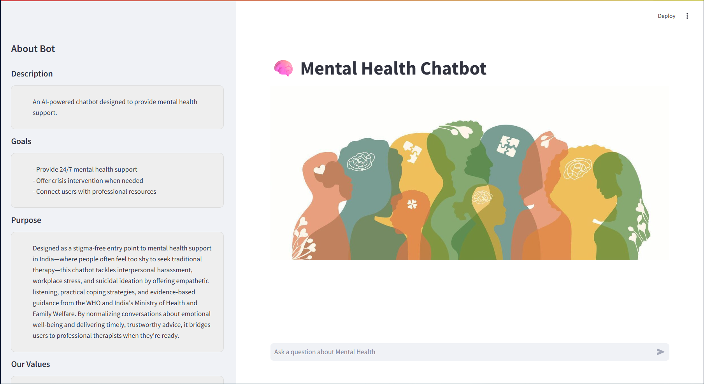
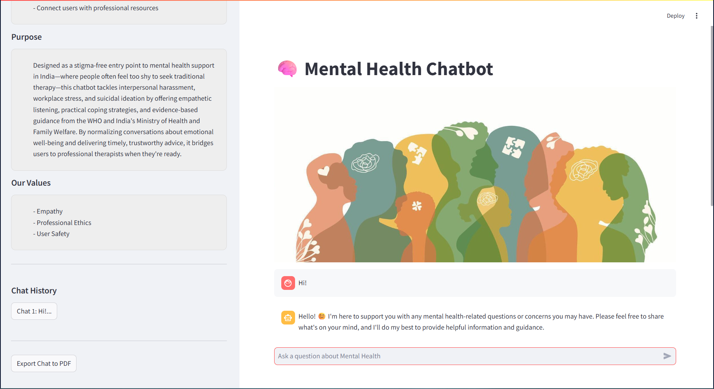
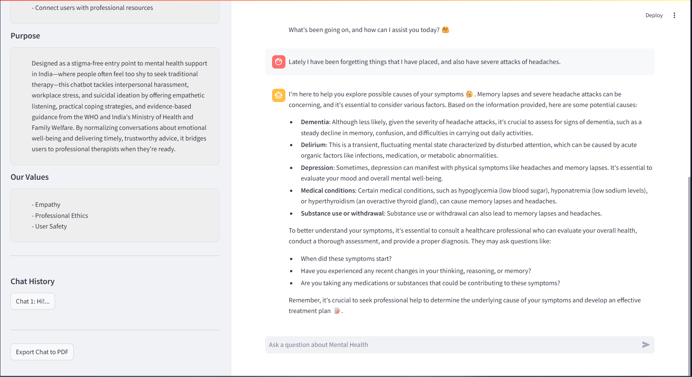

# **Mental Health Chatbot**

**Final Year Project**
_A chatbot for mental health support using Retrieval-Augmented Generation (RAG) and trusted data sources._

---

## ILLM project deliverables

- [Final project presentation (PowerPoint)](docs/ILLM-Final-Project-Presentation.pptx)
- [Project report (Word)](docs/ILLM-Project-Report.docx)

## **Description**

The **Mental Health Chatbot** is built to provide real-time, reliable mental health-related information and support. The chatbot uses **Retrieval-Augmented Generation (RAG)** techniques to fetch data from vectorized mental health content sourced from authoritative institutions such as the **World Health Organization (WHO)** and the **Ministry of Health and Family Welfare, Government of India**.

Sensitive keywords like "self-harm" and "harm" are detected by the system, triggering responses with emergency helpline numbers, ensuring users get immediate help in distressing situations.

The bot is designed to support users by offering not only information but also crucial helplines when they might need it most.

---

## **Features**

- **Accurate Mental Health Information**: Fetches contextually relevant information from authoritative sources such as WHO and the Ministry of Health and Family Welfare, India.
- **Sensitive Topic Detection**: Automatically detects distressing keywords like "self-harm" or "harm" and responds with helpline numbers for immediate assistance.
- **Retrieval-Augmented Generation (RAG)**: Combines retrieval of relevant data from vector databases with generative responses for detailed and contextual answers.
- **User-Friendly Interface**: Developed with **Streamlit** to provide a smooth and intuitive interface for real-time interaction.
- **Real-Time Data Processing**: Uses **LangChain** for natural language processing and real-time querying of vectorized mental health data.
- **Text and PDF Processing**: Processes downloaded PDFs containing publicly available mental health data, enabling efficient querying of static resources.
- **Static Data Source**: The current data is based on static PDF documents but will be updated regularly in the future.

---

## **Tech Stack**

- **Python 3.13.3**
- **Streamlit 1.38.0**: For developing the chatbot's user interface.
- **LangChain**: For building conversational AI and handling text data processing.

  - **langchain-community==0.2.16**
  - **langchain-text-splitters==0.2.4**
  - **langchain-chroma==0.1.3**: For managing vectorized mental health data.
  - **langchain-huggingface==0.0.3**: For integrating HuggingFace models.
  - **langchain-google-genai>=1.0.0**: For Google Gemini API integration.

- **HuggingFaceEmbeddings**: For embedding mental health documents and improving data retrieval.
- **PyPDF2**: For reading and extracting content from mental health-related PDFs.
- **NLTK 3.8.1**: For basic text processing and tokenization.
- **pytesseract\~=0.3.13**: For OCR if processing image-based PDFs or scanned documents.
- **python-magic-bin==0.4.14**: For identifying file types when processing documents.

**LLM Model:**

- **ChatGoogleGenerativeAI** (Model: `gemini-1.5-flash` with temperature set to 0): Powered by Google Gemini API to generate empathetic, evidence-based, and context-aware responses based on user queries and retrieved mental health context.

---

## **Screenshots**





---

## **⭐ Star This Project**

If you find this project helpful, please consider giving it a star! Contributions are also welcome - see the [Contributing](#contributing) section below.

---

## **How to Run Locally**

### **Prerequisites**

1. **Python 3.12** or higher.
2. Install required dependencies:

   ```bash
   pip install -r requirements.txt
   ```

3. **Configure Gemini API Key**:
   Create a `config.json` file in the project root directory (or copy from `config.json.example`):

   ```json
   {
     "GEMINI_API_KEY": "your_gemini_api_key_here",
     "GEMINI_MODEL": "gemini-1.5-flash"
   }
   ```
   Alternatively, you can set the environment variable:
   ```bash
   export GEMINI_API_KEY="your_gemini_api_key_here"  # Linux/macOS
   $env:GEMINI_API_KEY="your_gemini_api_key_here"    # PowerShell
   ```

### **Running the Chatbot**

1. Clone this repository:

   ```bash
   git clone https://github.com/hkgohil/Mental-health.git
   cd Mental-health
   ```

2. Ensure the **mental health PDFs** are placed in the `data` folder and the vector database is initialized in `vector_db_dir`.
3. Start the Streamlit app:

   ```bash
   streamlit run main.py
   ```

4. The app will open in your browser where you can interact with the chatbot.

---

## **User Interaction**

- **Input**: Users can type their queries directly into the Streamlit interface.
- **PDF attachments**: Choose **Attach a PDF**, wait for the file to be ready, then ask a question about it. Answers use excerpts from that PDF and show the pages retrieved. Remove the attachment to return to the built-in mental health collection.
- **PDF limits**: The uploader accepts one PDF with selectable text, up to 20 MB, 200 pages, and 300,000 extracted characters. Image-only scans need OCR before upload, and password-protected files need to be unlocked. The app indexes the PDF in the current session and sends relevant excerpts to Gemini when answering.
- **Output**: The chatbot processes the query, retrieves relevant information from the vector database, and displays context-aware responses.
- **Sensitive Content**: If the system detects sensitive terms like "self-harm" or "harm," it will immediately provide helpline numbers and offer emergency resources.

---

## **Data Sources**

- **Mental Health PDFs**: The initial data for this chatbot is based on publicly available PDFs downloaded from trusted sources like WHO and the Ministry of Health and Family Welfare. These documents contain important mental health guidelines and helpline information.
- **Chroma Vector Database**: The data is vectorized and stored in the **Chroma** vector database, allowing for efficient querying and retrieval.

---

## **Future Improvements**

- **Dynamic Data Updates**: Currently, the data is static, but future iterations will implement a mechanism to update the mental health information regularly to stay current with new guidelines, data, and helplines.
- **Expanded Data Sources**: We plan to expand the data sources by integrating other publicly available mental health resources, including articles, online counseling services, and data from mental health professionals.
- **Personalized Responses**: Future versions may allow for a personalized user experience, providing suggestions based on a user’s emotional state or past interactions.
- **Integration with Mental Health Resources**: We aim to provide links to clinics, doctors, online counseling, and more.

---

## **Contributing**

⭐ **If you find this project helpful, please consider giving it a star!**

Contributions are welcome! Here's how you can help:

1. **Fork** this repository
2. Create a new branch for your feature (`git checkout -b feature/YourFeature`)
3. Make your changes and commit them (`git commit -m 'Add some feature'`)
4. Push to your branch (`git push origin feature/YourFeature`)
5. Open a **Pull Request**

Feel free to open issues for bug reports, feature requests, or questions!

---

## **License**

This project is licensed under the MIT License - see the [LICENSE](https://github.com/DeepShah1406/Mental-Health-Chatbot/blob/master/LICENSE) file for details.

---

## **Acknowledgments**

- **LangChain**: For building robust chains of logic for querying and text processing.
- **Chroma**: For efficiently managing and querying vectorized data.
- **WHO** and **Ministry of Health and Family Welfare, Government of India**: For providing the essential mental health guidelines.
